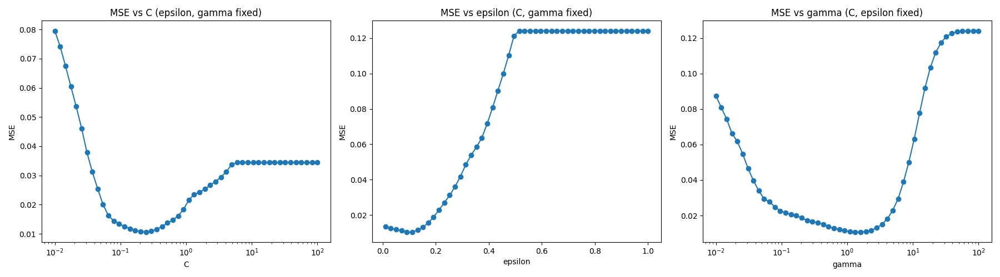

# SVR によるバレーボール対戦勝率の予測

> **実施時期:** 2025年7月
> **README 整理:** 2026年10月25日（就職活動での公開にあたり、README.md の整理のみを行いました。コード・データは実験当時のまま変更していません）

## 概要

バレーボールの国内トップリーグ SV.LEAGUE（男子）の各チームのレギュラーシーズン成績から、2チーム間の対戦勝率を予測するモデルを作りました。

- **入力:** 2チームの各種スタッツ（アタック決定率、ブロック得点、サーブ効果率、サーブレシーブ成功率など）の比（チームA / チームB）
- **出力:** チームA の対チームB 勝率
- **モデル:** RBF カーネルを用いた **サポートベクター回帰（SVR）を自前で実装**
  - scikit-learn の SVR は使わず、SVR の双対問題を 2 次計画問題として定式化し、`cvxopt` のソルバーで解いています（[src/svr.py](src/svr.py)）
  - サポートベクトルからバイアス項を求め、予測まで行っています
- **評価:** 10チームの全順序付きペア（90件）を学習データ 70件・テストデータ 20件に分け、平均二乗誤差（MSE）で評価しました
- **応用:** レギュラーシーズンで学習したモデルを使い、ファイナルラウンドの対戦の勝率を予測しました（[src/predict_final.py](src/predict_final.py)）

考察などの詳細はレポートにまとめています。

## 手法の流れ

1. **データ取得:** SV.LEAGUE 公式サイトの各チームの成績ページから、レギュラーシーズンの成績を取得（`requests` + `BeautifulSoup`）
2. **特徴量の作成:** 2チームのスタッツの比を特徴量にし、勝率（手入力した `winrates.csv`）を目的変数にして、ペアごとに CSV を作成
3. **ハイパーパラメータ探索:** C・ε・γ をグリッドサーチし、テストデータの MSE が最小になる組み合わせを探索
4. **感度分析:** 最適値の周りで各パラメータを 1つずつ動かし、MSE の変化をグラフにした

## 結果

ハイパーパラメータ探索の結果、次の値を採用しました。

| C | ε | γ |
|---|---|---|
| 0.2154 | 0.12 | 1.6681 |

各パラメータを動かしたときの MSE の変化（他の 2つは上の値で固定）:



## 使用技術

- Python
- NumPy / cvxopt（2 次計画問題）/ matplotlib
- requests / BeautifulSoup（スクレイピング）、pandas（データ整形）
- scikit-learn（MSE の計算のみ）

## ディレクトリ構成

```
SVR/
├── data/
│   ├── fetch_data.py            # 公式サイトからチーム成績を取得する関数
│   ├── save_data.py             # 全チームの成績を取得し regular_season_team_<id>.csv に保存
│   ├── team_ids.py              # チーム名とチームIDの対応表
│   ├── regular_season_team_*.csv # 取得した各チームの成績
│   ├── winrates.csv             # チーム間の対戦勝率（手入力）
│   ├── generate_data.py         # 2チームのスタッツ比と勝率から学習用データを作成
│   └── match_results/           # 学習用データ（<チームA>_div_<チームB>.csv）
├── results/
│   └── MSE.png                  # ハイパーパラメータごとの MSE の変化
├── src/
│   ├── svr.py                   # カーネル SVR の実装
│   ├── kernels.py               # RBF カーネル
│   ├── data_loader.py           # 学習用データの読み込み
│   ├── main.py                  # 学習・テストを行い MSE を表示
│   ├── search_parameters.py     # ハイパーパラメータのグリッドサーチ
│   ├── graphing.py              # パラメータごとの MSE の変化をグラフ表示
│   └── predict_final.py         # ファイナルラウンドの対戦の勝率を予測
└── requirements.txt
```

## 実行方法

```bash
pip install -r requirements.txt
```

学習・評価（リポジトリのルートで実行）:

```bash
python src/main.py               # MSE と予測値を表示
python src/search_parameters.py  # ハイパーパラメータ探索
python src/graphing.py           # MSE の変化をグラフ表示
python src/predict_final.py      # ファイナルラウンドの勝率予測
```

学習用データは `data/match_results/` に同梱しています。データを作り直す場合は次のとおりです。

```bash
python data/save_data.py                # ルートで実行（公式サイトから取得）
cd data && python generate_data.py      # data/ で実行
```

## データについて

- チーム成績は、2025年7月時点で [SV.LEAGUE 公式サイト](https://www.svleague.jp/) に掲載されていたものを取得・加工したものです。
- 対戦勝率（`winrates.csv`）は手作業で入力しました。

## 利用について

本リポジトリは、ポートフォリオとして閲覧していただくことを目的に公開しています。コード・データの無断転載・再利用はご遠慮ください。
